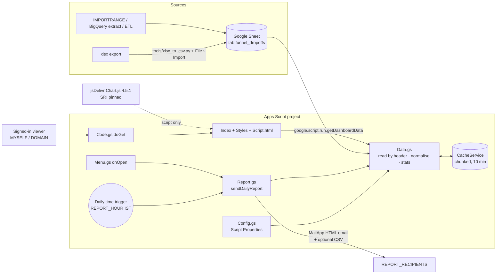

# Funnel Dashboard — Google Apps Script edition

The static `index.html` funnel dashboard, rebuilt as an Apps Script project that:

* **reads live** from a Google Sheet tab (`funnel_dropoffs`), matching columns by header name,
* serves the **same dashboard UX** as the static file (KPIs, clickable stage cards, funnel and breakdown charts, stage tabs 1–8 + Completed, drop/passed/all toggles, search, sort, CSV export) as a private **web app**,
* **refreshes daily** and **emails a daily HTML report** with day-over-day changes,
* sends **no data to third parties**: no QuickChart or image-chart services, and the email charts are pure HTML tables. The browser loads Chart.js from jsDelivr, pinned to an exact version with Subresource Integrity, and that download carries no data.

> ⚠️ The data contains customer names, emails and phone numbers. Keep the web app restricted (see **Security**).

## Files

```
src/                      ← everything clasp pushes (rootDir)
  appsscript.json         manifest: Asia/Kolkata, V8, minimal scopes, web app = USER_DEPLOYING / MYSELF
  Config.gs               defaults + Script Properties overrides (no code edits needed)
  Data.gs                 sheet → normalised rows (same JSON as build.py) → stats; chunked CacheService (10 min)
  Code.gs                 doGet(), include(), optional viewer allow-list, web app URL helper
  Report.gs               sendDailyReport(), sendTestReport(), installDailyTrigger(), removeTriggers()
  Menu.gs                 onOpen() “Funnel Dashboard” menu in the sheet
  Import.gs               docs only: ways to get daily data into the sheet
  Index.html              page shell (HtmlService template)
  Styles.html             original dark-theme CSS + loader/refresh styles
  Script.html             original client JS, now loading via google.script.run
tools/xlsx_to_csv.py      convert the current xlsx export to a Sheets-friendly CSV
test/                     local verification (Node mock of Apps Script + headless Chromium)
.clasp.json.example       copy to .clasp.json for clasp push
preview.png               local render of the web app Overview (mock data source)
report-preview.png        local render of the daily email. Its deltas come from a synthetic “yesterday” baseline.
```

## Architecture



Rules (same as the static dashboard): stage order comes from `max_stage` (1 offer … 8 delivery).
**Reached** = `max_stage ≥ k`. **Moved on** = `max_stage > k`, or completed at stage 8. **Dropped** = `max_stage == k` and not completed.
`drop_stage` is the next stage the user did not reach. `contact` is the pSIM branch after `sim_type`.

## Setup (about 15 minutes)

1. **Create the sheet.** Make a new Google Sheet and rename the first tab to `funnel_dropoffs`.
   Convert the export: `python3 tools/xlsx_to_csv.py data.xlsx` creates `data_funnel_dropoffs.csv`. Then use **File › Import › Upload › Replace current sheet**.
   Keep the header row. Column order doesn't matter. See `src/Import.gs` for IMPORTRANGE, BigQuery and ETL options.
2. **Open Apps Script.** In the sheet, go to **Extensions › Apps Script**. This creates a *bound* project, so `SHEET_ID` can stay blank.
3. **Add the code.** Pick one option:
   * **Paste:** In **Project Settings**, tick *Show "appsscript.json" manifest file in editor*. Then create each file with the same name and paste its contents: `Config`, `Data`, `Code`, `Report`, `Menu`, `Import` as Script files, and `Index`, `Styles`, `Script` as HTML files. Replace `appsscript.json` with the provided one.
   * **clasp:** Run `npm i -g @google/clasp && clasp login`. Copy `.clasp.json.example` to `.clasp.json` and set `scriptId` (Project Settings › IDs). Then run `clasp push` from this folder.
4. **Set Script Properties.** These are optional. Go to Project Settings › Script Properties:
   `REPORT_RECIPIENTS=you@company.com,team@company.com`, `ALLOWED_RECIPIENT_DOMAINS=company.com` (recommended), and optionally `REPORT_HOUR`, `DASHBOARD_TITLE`, `ATTACH_CSV`, `ALLOWED_VIEWERS`, `SHEET_ID` (only for a standalone project), `SHEET_NAME`, `CACHE_SECONDS`.
   The full list is in `Config.gs`.
5. **Authorise.** In the editor, select `showConfig` and press **Run**. Accept the scopes listed below.
6. **Deploy the web app.** Go to **Deploy › New deployment › Web app**. Set *Execute as: **Me***. Set *Who has access: **Only myself*** (the default), or ***Anyone within <your Workspace domain>***. **Never choose "Anyone".**
   Copy the `/exec` URL. If emails show no link, save it as the `WEBAPP_URL` property.
7. **Install the trigger.** Reload the sheet so the **Funnel Dashboard** menu appears. Choose **Install daily trigger**, or run `installDailyTrigger()` in the editor. This is idempotent: running it again replaces the existing trigger and never duplicates it.
8. **Test.** Choose **Funnel Dashboard › Send test report (to me)**. This sends only to you, adds `[TEST]` to the subject, and doesn't change the day-over-day baseline. Then use **Open dashboard**.

After you change code, use **Deploy › Manage deployments › Edit › Version: New version** so the `/exec` URL serves the new code.

### OAuth scopes (minimal)

| Scope | Why |
|---|---|
| `spreadsheets.readonly` | read the data tab (the script never writes to the sheet) |
| `script.send_mail` | MailApp daily report |
| `script.scriptapp` | create and delete the daily trigger, get the web app URL |
| `script.container.ui` | sheet menu, prompts and dialogs |
| `userinfo.email` | identify the viewer for the optional `ALLOWED_VIEWERS` list and for test-report delivery |

PropertiesService, CacheService, LockService and HtmlService need no extra scopes.

## Daily behaviour

The trigger `dailyReportTrigger` runs once a day during `REPORT_HOUR` (Asia/Kolkata). It clears the cache, re-reads the sheet (which also warms the cache for viewers), and emails the report.
* **KPIs:** total users, converted, conversion rate and completed, each with a Δ against the previous scheduled run (stored in `LAST_REPORT_KPIS`).
* **Stage funnel table:** reached, moved on, dropped, step conversion, Δ reached, plus inline bars.
* **Also included:** top drop stage, the latest first-seen day, a drop_stage breakdown, and a button to the web app.
* **Duplicate protection:** a second scheduled send on the same day is skipped. To resend, use the menu item **Send report now** or `sendDailyReport({force:true})`.
* **CSV attachment:** `ATTACH_CSV=true` attaches `funnel_dropoffs_by_stage_<date>.csv`, which lists every non-completed user with contact details, sorted by stage. It's **off by default**.
* **Web app freshness:** the web app serves data at most `CACHE_SECONDS` (10 min) old. **⟳ Refresh** re-reads the sheet immediately, and an open tab reloads itself every 30 minutes.

## Changing recipients

Use **Funnel Dashboard › Set report recipients…**, which validates the list and saves it to Script Properties. You can also edit `REPORT_RECIPIENTS` in Project Settings. No redeploy is needed.
If `ALLOWED_RECIPIENT_DOMAINS` is set, any address outside those domains is dropped and logged.
To change the send time, set `REPORT_HOUR` and run **Install daily trigger** again.

## Security notes

* **Web app access:** the manifest defaults to `"access": "MYSELF"`. For a Google Workspace account, `"DOMAIN"` (Anyone within your domain) is the widest sensible setting. **Do not use `ANYONE` or `ANYONE_ANONYMOUS`**, because the page lists customer contact details. With *Execute as: Me*, every viewer sees the data with your permissions.
* **Viewer allow-list:** `ALLOWED_VIEWERS` narrows a DOMAIN deployment to named people. It's enforced in `doGet` and in every `google.script.run` call. Viewers outside your Workspace domain have no readable email and are denied.
* **Email contents:** the email body holds aggregates only. Keep `ATTACH_CSV=false` unless every recipient may see PII, and set `ALLOWED_RECIPIENT_DOMAINS`. CSV cells are protected against formula injection.
* **No third parties:** nothing is sent to external services. The only external request is the browser downloading Chart.js from jsDelivr, pinned to `4.5.1` with an `integrity` hash.
* **Framing:** `XFrameOptionsMode.DEFAULT` stops other sites from embedding the page.
* **Access to the data:** only people with access to the Apps Script project or the sheet can see the data, so share both carefully. Script Properties hold no secrets.

## Troubleshooting

| Symptom | Fix |
|---|---|
| “Sheet tab "funnel_dropoffs" not found” | Rename the tab, or set `SHEET_NAME`. |
| “No spreadsheet: set Script Property SHEET_ID” | This is a standalone project. Set `SHEET_ID` to the ID in the sheet URL (`/d/<ID>/edit`). |
| “Missing required column(s)” | The header row needs `user_pseudo_id, outcome, max_stage, completed, first_seen_date`. |
| Dashboard shows old data | Click **⟳ Refresh**, or use the menu item **Refresh data cache**. |
| Code changes not visible at `/exec` | Deploy a **new version** (Manage deployments › Edit). `/dev` always runs the latest code but only works for editors. |
| No dashboard link in the email | Set `WEBAPP_URL` to the `/exec` URL. |
| Charts missing, tables fine | The browser couldn't reach `cdn.jsdelivr.net` (proxy or extension). Allow it, or paste the Chart.js file into a new `ChartJs.html` as `<script>…</script>` and swap the `<script src>` tag in `Index.html` for `<?!= include('ChartJs'); ?>`. |
| CSV export button does nothing | Some browsers block downloads from the sandboxed iframe. The button falls back to opening the CSV in a new tab. |
| Menu missing | Reload the sheet. The menu only exists for a project bound to the sheet. |
| No email arrives | Check `REPORT_RECIPIENTS` and `ALLOWED_RECIPIENT_DOMAINS`, then **Executions** in the editor. MailApp's daily quota is 100 recipients/day for consumer accounts and 1,500 for Workspace. |
| “Report already sent today” | This is duplicate protection. Use **Send report now** or `sendDailyReport({force:true})`. |
| Trigger fires twice | Run `removeTriggers()` and then `installDailyTrigger()`. Triggers are per user, so check that another editor hasn't installed one too. |

## Local verification

`test/run_all.sh [path/to/data.xlsx]` runs four checks:
1. `node --check` on every `.gs` file and on the client `<script>`, plus manifest validation.
2. The real `.gs` files in a Node mock of the Apps Script runtime, using the xlsx data.
3. Checks that rows match `build.py` field for field, that stage counts are right, and that chunked caching, the report and the triggers work.
4. A headless-Chromium render of `Index.html` with a mock `google.script.run`.

Fixtures contain PII and are written to `/tmp` only.
